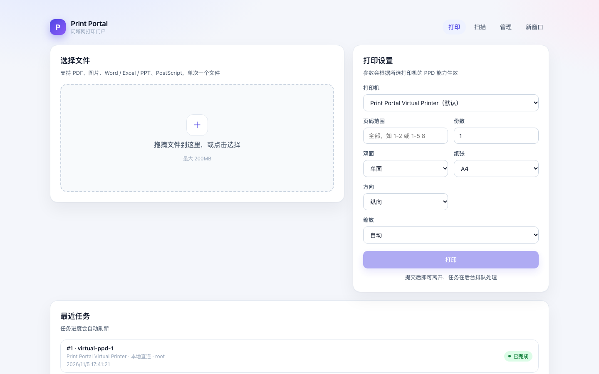
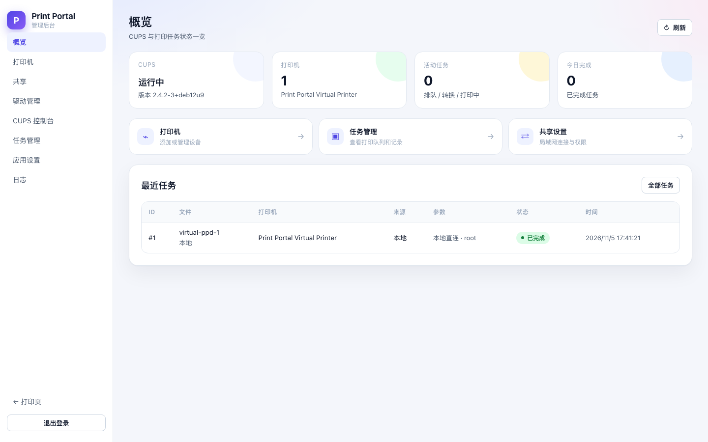
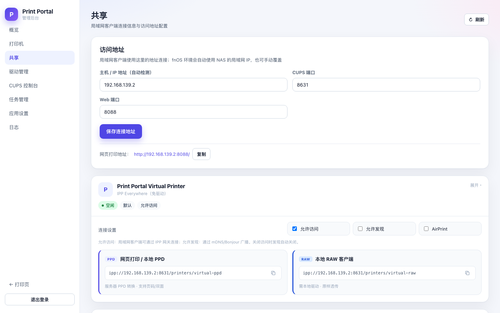
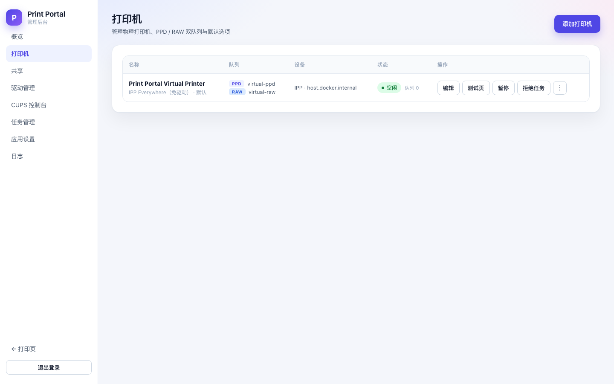
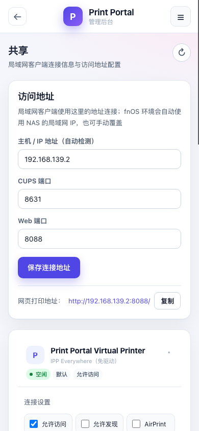
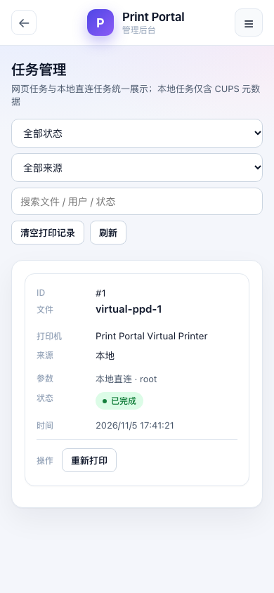

# Print Portal（打印门户）

> **把一台普通打印机，变成全屋 / 全办公室随取随用的打印门户。**

Print Portal 是一个面向 **家庭、小办公室、fnOS NAS** 的单用户局域网打印中心。它把 CUPS、打印驱动、文件转换、网页上传、IPP 网关、AirPrint 广播和任务管理整合进一个 Docker 容器，让没有打印服务器的普通 USB / 网络打印机也能被电脑、手机、平板直接使用。

> 当前版本：`0.2.8` · 许可证：Apache-2.0

## 界面预览

### 网页打印



### 管理后台







<details>
<summary>移动端界面</summary>





</details>

## 为什么需要 Print Portal

家庭和小办公室里的打印机通常有三个问题：

1. **只有接 USB 的那台电脑能打印**
2. **每台设备都要装驱动，手机和平板尤其麻烦**
3. **CUPS 功能很强，但配置、队列、PPD、IPP 地址对普通用户太复杂**

现有方案通常只解决其中一部分：

- CUPS Web UI：专业、但更像管理员工具
- CUPS + Avahi：只是广播打印机，仍要手工配置
- 云打印 / 打印服务器：依赖账号、云端或额外硬件
- NAS 自带打印：驱动少、格式少、没有网页上传和任务管理

Print Portal 想解决的是完整的一整条链路：

```text
任何设备
  → 网页上传 / AirPrint / IPP
  → Print Portal
  → CUPS + PPD 驱动
  → 普通 USB / 网络打印机
```

## 核心价值

### 1. 一台打印机，所有设备都能用

- iPhone / iPad / Mac：AirPrint 自动发现
- Android：Mopria / Default Print Service
- Windows / Linux：标准 IPP
- 任何浏览器：直接打开网页上传打印

不需要在每台手机、平板上安装厂商驱动。

### 2. 不装客户端，网页就是打印入口

支持 PDF、图片、Word、Excel、PPT、PostScript：

```text
上传 → 预览 → 设置页码/份数/双面/纸张 → 打印
```

服务端统一转 PDF，再由 CUPS PPD 驱动输出，避免每台客户端重复安装驱动。

### 3. 数据留在本地，不经过云端

- 自己的 Docker
- 自己的 CUPS
- 自己的 SQLite
- 自己的局域网
- 不需要注册账号，不需要第三方云打印服务

### 4. 把 CUPS 的复杂度藏起来

应用自动完成：

- 创建 PPD / RAW 双队列
- 发现 USB / 网络打印机
- 安装 / 切换 / 上传 PPD 驱动
- 管理 IPP 地址
- 清理队列和历史
- 查看任务状态

用户不需要理解 CUPS 的 `lpadmin`、PPD、filter、queue。

### 5. 真正为“一台打印机”设计

不是企业打印管理系统，不引入用户、部门、配额、审批。

它专注：

```text
一个管理员
一台物理打印机
一个局域网
所有家人 / 同事共用
```

### 6. fnOS 原生集成

- fnOS 应用中心安装
- 使用飞牛统一网关登录，不需要额外 Token
- 支持 fnOS 原生文件选择器，直接选择 NAS 文件打印
- 内置 AirPrint mDNS，不依赖宿主 Avahi / D-Bus
- 移动端管理页面适配

## 和常见方案的区别

| 方案 | 网页上传 | 服务端转换 | 手机免驱 | 任务管理 | 一体化部署 |
|---|---|---|---|---|---|
| CUPS Web UI | ❌ | ❌ | ❌ | 基础 | ❌ |
| cups-airprint | ❌ | ❌ | ✅ | ❌ | 需要额外配置 |
| 云打印服务 | ✅ | 部分 | ✅ | 部分 | 依赖云端 |
| NAS 自带打印 | 部分 | 部分 | 部分 | ❌ | 部分 |
| **Print Portal** | ✅ | ✅ | ✅ | ✅ | ✅ 单容器 |

目前市面上很少有项目把「网页上传 + Office 转换 + PPD/RAW 双队列 + IPP 网关 + AirPrint 广播 + 任务管理 + fnOS 认证」整合到一个单容器里；多数项目只解决其中一个环节。

## 主要功能

- **网页打印**：PDF、图片、Word / Excel / PPT、PostScript
- **文件预览**：PDF / 图片直接预览，支持移除重选
- **打印参数**：页码、份数、单双面、纸张、方向、颜色、缩放
- **页码范围校验**：按实际页数限制，图片固定 1 页
- **大文件分块**：按 `chunk_pages` 拆分，降低 USB / 打印机缓冲压力
- **打印机管理**：USB / 局域网发现、IPP Everywhere、PPD 驱动库、上传驱动
- **PPD + RAW 双队列**：网页 / 免驱走 PPD，本地驱动客户端走 RAW
- **AirPrint / Mopria**：内置 mDNS 广播，按打印机独立开关
- **NAS 文件打印**：fnOS 原生文件选择器，授权后直接读取
- **任务管理**：状态搜索、来源筛选、取消 / 暂停 / 恢复 / 重新打印
- **队列维护**：清空队列、清空打印记录、同步清理 CUPS 历史
- **驱动维护**：驱动状态、型号索引、上传安装 / 卸载、维护动作
- **双认证模式**：fnOS 统一网关 / 独立版 Token
- **移动端管理**：打印机、任务、共享、驱动、CUPS、日志页面适配手机

## 2. 架构

```text
浏览器 / 手机
      │  HTTP :8088
      ▼
┌─────────────────────────────┐
│ printd                      │
│  Vue 前端 + Go API          │
│  SQLite 任务队列            │
│  文件转换 / PDF 渲染        │
│  IPP 网关 :8631             │
└──────────────┬──────────────┘
               │ 127.0.0.1:631
               ▼
┌─────────────────────────────┐
│ CUPS（容器内）              │
│  PPD 队列  +  RAW 队列      │
└──────────────┬──────────────┘
               │ USB / LAN
               ▼
            打印机
```

- 网页打印：**应用内 PPD 渲染 → RAW 队列**，不依赖 CUPS 的 `pdftopdf` 路径
- 本地已安装驱动的客户端：使用 **RAW 队列**（客户端已经渲染成打印机原生数据）
- 本地免驱 / IPP Everywhere 客户端：使用 **PPD 队列**（提交 PDF，由服务端处理）

详细设计见 [架构文档](docs/ARCHITECTURE.md)。

## 3. 快速开始（Docker）

### 3.1 准备

- Linux 主机（推荐 fnOS / Debian 12，x86_64）
- Docker 24+ 与 Docker Compose v2
- USB 打印机已连接到主机
- 局域网固定 IP（例如 `192.168.2.30`）

### 3.2 配置

复制示例环境变量并按实际情况修改：

```bash
cp .env.example .env
```

至少修改：

```dotenv
ADMIN_TOKEN=换成一个足够长的随机字符串
```

### 3.3 启动

普通 Docker 用户直接使用预构建镜像，不需要构建：

```bash
cp .env.example .env
# 编辑 ADMIN_TOKEN，可选 PRINT_PORTAL_PUBLIC_HOST
docker compose -f docker-compose.standalone.yml up -d
```

从源码构建：

```bash
docker compose up -d --build
```

fnOS 用户使用 fpk：

```text
dist/print-portal_0.2.8_x86.fpk
```

启动后访问：

```text
http://<主机局域网IP>:8088/
管理后台：http://<主机局域网IP>:8088/admin
```

### 3.4 添加打印机

1. 打开管理后台，输入 `ADMIN_TOKEN`
2. 进入「打印机」→「添加打印机」
3. 选择扫描到的 USB / 局域网设备，或手动填写 IPP / socket 地址
4. 选择驱动：
   - 支持 IPP Everywhere 的设备：勾选「免驱动」
   - USB 或已知型号：从驱动库选择 PPD
   - 找不到型号：上传 PPD 或驱动包
5. 保存后会创建两个队列：
   - `<name>-ppd`
   - `<name>-raw`

> 队列名由应用自动生成；实际名称以管理页和「共享」页显示为准。

## 4. 网页打印

打开：

```text
http://<主机IP>:8088/
```

流程：

1. 拖拽或选择文件
2. 查看预览；右上角 `×` 可移除文件
3. 设置页码、份数、双面、纸张、方向、颜色、缩放
4. 点击「打印」

任务提交后立即返回，转换和打印在后台队列执行。页面「最近任务」会自动刷新。

### 4.1 页码范围

- 输入格式：`1-2`、`1-5 8` 或 `1-2,4`
- 支持 PDF 的实际页数校验
- 图片按 1 页计算
- Word / Excel / PPT 在服务端转换完成后再次校验

## 5. 本地客户端使用

管理页「共享」页会显示当前打印机的两个地址：

```text
PPD: ipp://<主机IP>:8631/printers/ppd-queue
RAW: ipp://<主机IP>:8631/printers/raw-queue
```

### 5.1 本地已安装驱动（推荐 RAW）

如果本地已经安装 Brother / 厂商 PPD 驱动，客户端会先在自己的电脑上渲染，服务器只负责转发原生打印数据：

```text
客户端 PPD 驱动 → ipp://<主机IP>:8631/printers/<raw-queue>
```

适合：macOS 使用 Brother PPD、Windows 使用厂商驱动。

### 5.2 免驱 / IPP Everywhere（PPD 队列）

支持 IPP Everywhere 的客户端可以直接提交 PDF：

```text
客户端 IPP Everywhere → ipp://<主机IP>:8631/printers/<ppd-queue>
```

服务器使用 PPD 过滤器渲染后打印。

### 5.3 本地驱动注意事项

- 本地 PPD 驱动发送的是 **PJL / PCL 等打印机原生数据**，请使用 **RAW 队列**
- 把本地驱动数据发到 PPD 队列会导致服务器重复过滤，可能失败
- 本地驱动对异常页面尺寸（例如超大 PDF 页面）可能不会自动缩放；建议使用网页打印或先将 PDF 归一化为 A4

## 6. 安全建议

- **不要把 8631 端口暴露到公网**
- 公网只暴露 Web 入口（例如 fnOS 域名反代到 8080）
- 在路由器 / fnOS 防火墙中限制：
  - 允许 `192.168.x.0/24` 访问 `8631`
  - 拒绝其他来源
- `ADMIN_TOKEN` 必须修改为强随机字符串
- IPP 网关只接受私网 / 回环来源；RAW 请求有 500MB 上限
- 定期备份 `data/`、`cups-etc/`、`cups-spool/`、`cups-log/`

> RAW 队列不做格式过滤：任何人都不要将 RAW 地址暴露到公网，否则可能收到任意打印数据。

## 7. 目录与持久化

容器内：

```text
/app/data             SQLite、任务文件、驱动、临时文件
/etc/cups             打印机配置、PPD、cupsd.conf
/var/spool/cups       打印队列
/var/log/cups         CUPS 日志
```

建议将以上目录全部挂载到宿主机持久卷。

## 8. 常用运维命令

```bash
# 查看服务健康
curl http://127.0.0.1:8088/healthz

# 查看容器状态
docker compose ps

# 查看日志
docker compose logs -f print-portal

# 查看 CUPS 队列
docker exec print-portal lpstat -p
docker exec print-portal lpstat -o
```

## 9. 常见问题

### 打印出来的页面尺寸不对 / 数据很大

检查源 PDF 的页面尺寸。某些导出文件会把 300dpi 像素当成 PDF point，页面可能达到几十厘米。网页打印会按 A4 和适合页面处理；本地 PPD 驱动需要在打印时选择 A4 / 适合页面，或先归一化 PDF。

### 本地 PPD 打印失败

确认本地 PPD 驱动连接的是 **RAW 队列**，不是 PPD 队列。

### 清空打印记录会不会删除 CUPS 记录

会。应用会短暂设置 CUPS `PreserveJobHistory=No` 清除现有历史，然后恢复为 `Yes`，之后的新 CUPS 历史继续保留。

### 打印机缺纸 / 后端卡住

先检查打印机面板；CUPS 显示 `Sending data to printer` 但长时间不结束时，优先检查缺纸、卡纸、USB 连接和打印机电源。

更多说明见：

- [用户使用指南](docs/USER_GUIDE.md)
- [分享给别人使用](docs/SHARING.md)
- [fnOS 应用包 / 上架说明](docs/FNOS_PACKAGE.md)
- [成为 fnOS 开发者并上架](docs/FNOS_DEVELOPER.md)
- [部署说明](docs/DEPLOYMENT.md)
- [常见问题](docs/FAQ.md)
- [API 文档](docs/API.md)
- [架构设计](docs/ARCHITECTURE.md)
- [认证模式](docs/AUTH.md)
- [AirPrint / Mopria](docs/AIRPRINT.md)
- [使用 NAS 文件打印](docs/NAS_FILES.md)

## 10. 开发

```bash
# 后端
go run ./cmd/printd

# 前端
cd web
pnpm install
pnpm dev

# 检查
go test ./...
cd web && pnpm typecheck && pnpm build
```

## License

[Apache License 2.0](LICENSE)
